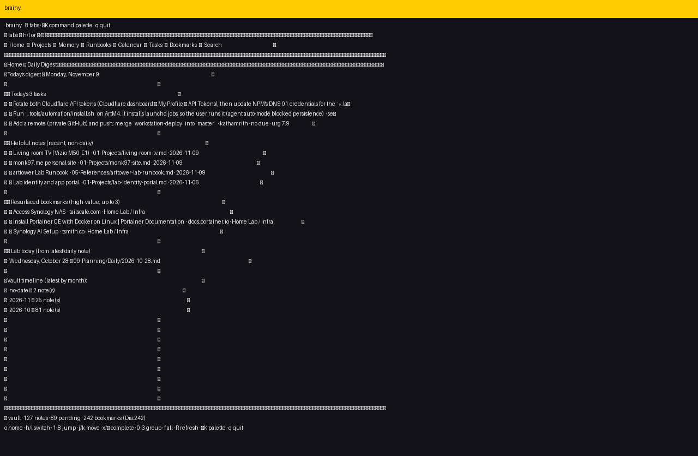
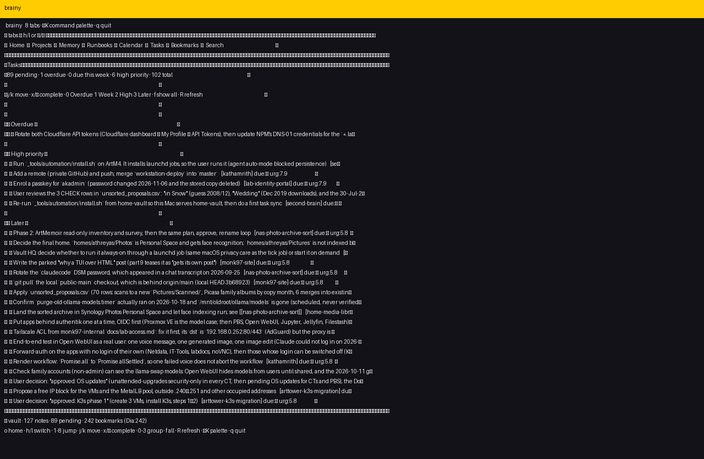
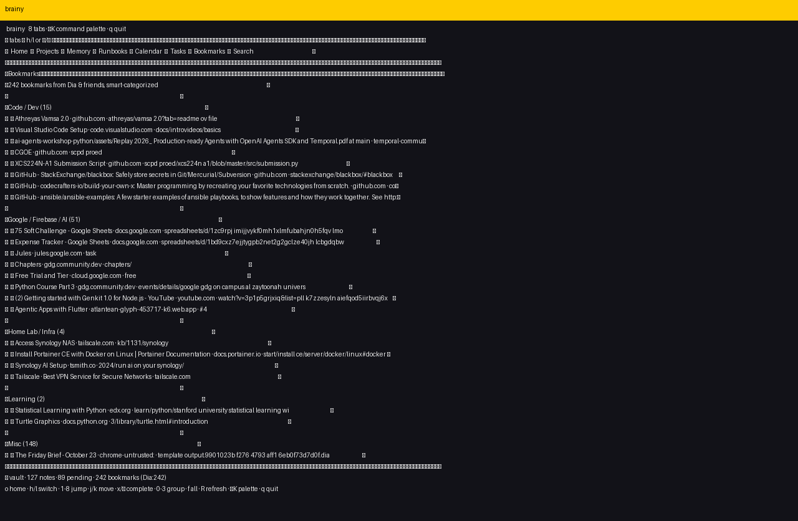

# Brainy

A second-brain dashboard for one person, one Mac, many agents.

Every coding agent you run — Claude Code, Cursor, Codex — writes its memory into
one Obsidian vault (plain Markdown + YAML frontmatter). Brainy sits on top of
that folder and scrapes through it, then gives you a **single, high-level
overview**: what you worked on, what's next, what to read, and what's saved
across the web.

It also reads your browser bookmarks (Chromium-based browsers: Dia, Chrome,
Arc, Edge, Brave, Vivaldi), categorizes them, and keeps them searchable in
the same place.







## Quick start

```bash
cargo run        # TUI (default)
# or
open ~/Library/Developer/Xcode/DerivedData/BrainyApp-*/Build/Products/Debug/BrainyApp.app
```

**Keyboard only — no mouse needed.** Top tabs, `⌘K` command palette, vim keys.

| Key | Action |
|---|---|
| `o` / `1` | Home (Daily Digest) |
| `p` / `2` | Projects |
| `m` / `3` | Memory |
| `a` / `4` | Runbooks |
| `d` / `5` | Calendar |
| `t` / `6` | Tasks |
| `b` / `7` | Bookmarks |
| `s` / `8` | Search |
| `h` / `l` or `←` / `→` | switch tab |
| `j` / `k` or `↑` / `↓` | move |
| `x` or `Enter` | complete task (in Tasks) |
| `0` `1` `2` `3` / `f` | task group filter / show all |
| `⌘K` or `Ctrl-K` | command palette |
| `R` | refresh |
| `q` | quit |

## What it reads

| Source | Path / tool | What Brainy does |
|---|---|---|
| Obsidian vault | `~/Library/Mobile Documents/iCloud~md~obsidian/Documents/home-vault` | parses 127 Markdown notes, frontmatter, checkboxes, daily notes, timeline |
| Taskwarrior | `task export` (via CLI) | 89 pending, 12 completed; groups Overdue / Week / High / Later; `x` completes via `task <id> done` |
| Browser bookmarks | `~/Library/Application Support/{Dia,Arc,Chrome,Edge,Brave,Vivaldi}/…/Bookmarks` | flattens Chromium trees, dedupes by URL, categorizes into 9 smart buckets |

Override the vault location:

```bash
BRAINY_VAULT=/some/other/vault cargo run
```

## Sections

### Home — Daily Digest

The welcome screen. No mouse, no hunting:

- **Today's 3 tasks** — the most urgent from Overdue → Due-this-week → High priority
- **Helpful notes** — recently edited project & runbook notes (not daily notes)
- **Resurfaced bookmarks** — up to 3 high-value bookmarks (Home Lab / Google AI / Learning), deterministic
- **Vault timeline** — notes per month

### Projects / Memory / Runbooks

Clean cross-sections, not every file dumped:

- **Projects** — `01-Projects/` (14 notes)
- **Memory** — `06-Memory/sessions/` (6) + `memory/` (42 atomic facts)
- **Runbooks** — `05-References/` (10 notes)

### Calendar

Month strip (● = daily note exists) + daily notes + weekly plans.

### Tasks

89 pending tasks in 4 clean groups; each task appears **exactly once**:

1. Overdue (1)
2. Due this week (0)
3. High priority (6)
4. Later (82)

`j`/`k` move, `x`/`Enter` completes (calls `task <id> done`), `0-3` filters a group, `f` shows all.

### Bookmarks

242 bookmarks from Dia (Default + Profile 2), deduped. Categories:

Vault & Docs · Home Lab / Infra · Google / Firebase / AI · Code / Dev ·
Learning · Video · Social / Productivity · Misc · Unsorted

`Misc` is the largest bucket (148) — mostly work-related Zscaler folders.
Bottom bar shows per-browser counts: `Dia:242`.

## Video


(Recorded by driving the TUI in tmux and assembling frame-by-frame captures;
`screencapture` is blocked in headless agent sessions, so frames are rendered
from terminal text.)

## Project structure

```
src/
  main.rs       TUI (ratatui + crossterm)
  vault.rs      vault scanning, frontmatter, timeline
  tasks.rs      Taskwarrior via CLI
  bookmarks.rs  Chromium Bookmarks parser + categorizer
BrainyApp/      native SwiftUI macOS app (V1, sidebar/detail)
assets/         screenshots + demo video
```

## Data — how the vault is organized

The vault mirrors how agents write. Zones (from `AGENTS.md`):

- **Machine** (`00-Inbox/`, `06-Memory/`, `_tools/`) — agents write freely
- **Shared** (`01-Projects/`, `03-Learning/`, `05-References/`, `07-Agents/`) — edit in place
- **Human** (`04-Personal/`, `09-Planning/`) — read-only to agents

Every note has frontmatter: `title`, `type`, `created`, `updated`, `author`,
`tags`. The `type` field is the main index: `agent-memory (43)`, `project (14)`,
`daily (14)`, `session-log`, `runbook`, `reference`, `learning`,…

Taskwarrior round-trips the vault: checkboxes carry `🆔` ids that map to
Taskwarrior custom fields. All 89 pending tasks live on this Mac.

## Building

```bash
# Rust TUI
cargo build --release

# SwiftUI app
xcodegen generate   # after adding source files
xcodebuild -project BrainyApp/BrainyApp.xcodeproj -scheme BrainyApp -configuration Debug build
```

Chain-of-thought is kept out of the code; comments are terse.

## FAQ

**Why TUI first?** The user asked for a keyboard-only interface: top tabs,
`⌘K`, no mouse. The native SwiftUI app exists as V1 but the TUI is the main path.

**Why not just Open Obsidian?** Obsidian shows 127 raw files. Brainy answers
"what matters *today*" — 3 tasks, a few notes, a few bookmarks — in one screen.

**Will it edit my vault?** No. Brainy is read-only on the vault. Taskwarrior
completions (`x`) write only via the `task` CLI.

## License

Personal use.
